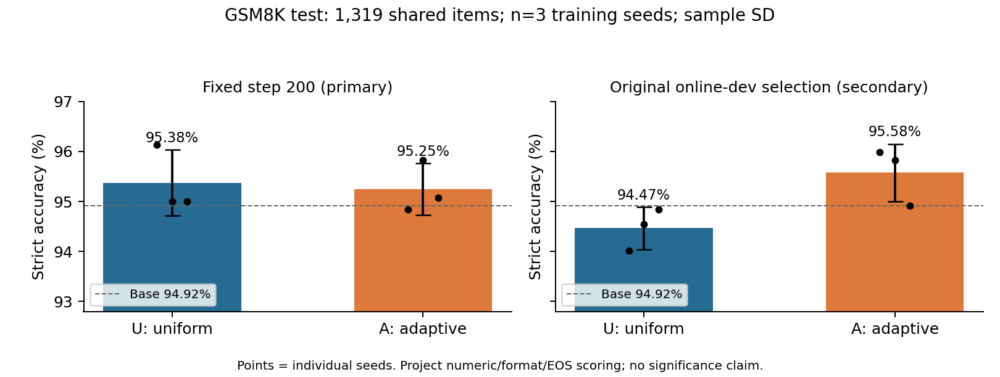
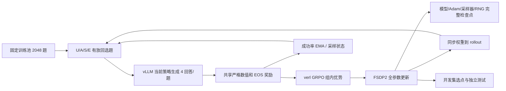

# Difficulty GRPO：两卡全参数数学推理训练与采样研究

给定有限算力，应该把下一批训练预算分给哪些题？本项目在同机 **2×A100 80GB** 上，对 **Qwen3.5-9B 做全参数 GRPO**，比较均匀采样与基于历史成功率的在线难度采样，并提供断点续训、评测一致性核验及失败分析。

你可以无需 GPU 运行采样/奖励演示、核验公开结果与源码哈希；也可以在 Linux GPU 环境重建固定依赖、准备公开数据并运行真实训练。公开包不含训练权重、原始回答、完整数据集或虚拟环境。

**主要结果是可信的比较及负结果：固定第 200 步，难度采样没有稳定胜过均匀采样，而且成本更高。** 本仓库适合展示 LLM 强化学习的工程实现、实验控制和证据分析，不提供线上业务服务或生产可用性保证。

## 实验成果

完成 U/A 各 3 个训练种子（42/43/44）、S/E 各 1 个种子（42），共 8 组、每组 200 更新步。固定测试计划包含 17 个报告角色，引用 15 份不同权重。以下均为 **GSM8K 官方测试划分 1,319 题上的本项目严格数值/格式/EOS口径**，不代表官方排行榜协议。

|终点|均匀采样 U|在线难度 A|A−U|
|---|---:|---:|---:|
|固定第 200 步（主终点）|95.38% ± 0.66|95.25% ± 0.52|−0.13 个百分点|
|原在线开发集选点（次终点）|94.47% ± 0.42|95.58% ± 0.57|+1.11 个百分点|

± 为 3 个训练种子的样本标准差，单位为百分点；不是置信区间。基座为 1252/1319（94.92%）。所有模型使用同一测试集，不能把 1319×3 当作独立题目样本数。原在线选点来自存在生成噪声的历史流程，不称为参考评测下全程真正最佳。



A 的已记录训练卡时均值 30.71，U 为 28.77；A 多 6.74%。训练回答 token 均值 20.61M 对 17.47M，多 17.94%。这些账本含初始化、恢复、保存和在线验证等已记录开销，新增离线评测单独记账。混合奖励组均值约从 5.10% 增至 13.62%，但它是学习信号代理，不能替代泛化和效率结论。

详细数值、单种子消融及限制见 [实验报告](docs/EXPERIMENTS.md)；可重新统计的公开评分见 [evidence](evidence/results.json)。**本次发布没有训练、模型推理或 GPU 验收**；历史实验依据远程私审包核对，见 [检查记录](docs/VALIDATION.md)。

## 系统架构与流程



同机两卡在同步阶段复用训练和 rollout 资源。训练 rollout 使用 TP2，离线参考评测使用 TP1，两卡可分别评独立模型；两者不是同一解码拓扑。完整实现与接口见 [架构说明](docs/ARCHITECTURE.md)。

## 核心方案与源码

二元奖励组的所有回答相同时，组内中心化后的**任务奖励优势**为零；KL loss 等其他梯度仍可能存在。项目用成功率不确定性作为启发式：

```text
首次访问：p_i = 当前四回答的平均正确率
后续访问：p_i = 0.7 * p_i + 0.3 * 当前组正确率
s_i = p_i * (1 - p_i)
A: q_i = 0.2/N + 0.8 * s_i/sum(s)
E: q_i = s_i/sum(s)
sum(s)==0 时退回均匀；前 20 步统一均匀；S 在预热后冻结 p_i
```

有放回选题；同题重复出现也分配独立回答组 UID。只复用难度统计，每次重新生成回答。不做难度采样的重要性校正，因此优化的是被改变的题目分布。这是对既有 GRPO 的采样改造，不是新提出 GRPO。

|位置|职责|
|---|---|
|[sampler.py](dagrpo/sampler.py)|选题、EMA、均匀探索、随机数和状态恢复|
|[train.py](dagrpo/train.py)|绑定同步 trainer、按 UID 反馈、关闭预取、检查点提交与恢复|
|[full_engine.py](dagrpo/full_engine.py)|拒绝 LoRA/冻结参数、优化器覆盖和真实权重更新审计|
|[runner.py](dagrpo/runner.py)|固定算法批量、FSDP2/CPU 卸载/rollout 配置、账本和过程监督|
|[reward.py](dagrpo/reward.py)、[verl_reward.py](dagrpo/verl_reward.py)|训练/评测共享数值解析及 EOS 元数据|
|[evaluate.py](dagrpo/evaluate.py)|固定 TP1、BF16、greedy、分块和结束判定|
|[eval_queue.py](dagrpo/eval_queue.py)、[test_plan.py](dagrpo/test_plan.py)|测试前固定角色，复用已完整校验结果|

参数审计记录 9,409,813,744 个参数全部可训练，760 个张量进入优化器，无 adapter；抽样基础权重变化和有限梯度支持真实更新，不声称每个元素每一步都非零变化。使用 FP32 主参数、BF16 计算、FSDP2 原生 CPU 卸载，因而主机内存/带宽也是资源约束。

## 最小示例：无需 GPU

**本地 Windows PowerShell**：先把 `$Project` 设置为本候选目录的绝对路径。只用 Python 标准库，不安装训练依赖。

```powershell
$Project = Read-Host '解压后的项目绝对路径'
Set-Location -LiteralPath $Project
python -B tools/verify_release.py
if ($LASTEXITCODE -ne 0) { throw '校验失败，请保留原始报错' }
python -B examples/sampler_demo.py
if ($LASTEXITCODE -ne 0) { throw '演示失败，请保留原始报错' }
python -B tools/summarize_results.py
if ($LASTEXITCODE -ne 0) { throw '统计失败，请保留原始报错' }
python -B -X utf8 -m unittest discover -s tests -v
if ($LASTEXITCODE -ne 0) { throw '测试失败，请保留原始报错' }
```

**Linux 终端，在解压后的候选项目根目录执行**：

```bash
python3 -B tools/verify_release.py
python3 -B examples/sampler_demo.py
python3 -B tools/summarize_results.py
python3 -B -m unittest discover -s tests -v
```

演示使用明确标注的人造奖励，不加载模型、不证明模型效果。缺少 torch/torchdata/verl 的集成检查会跳过。`test_core` 中一个历史报表测试在无 matplotlib 的纯标准库环境仍会尝试导入绘图库；[复现说明](docs/REPRODUCE.md)给出依赖要求与本轮记录，不能把跳过或依赖失败当作完整服务器验收。

## 真实训练与推理：Linux GPU

固定上游 verl v0.9.1 的干净提交 `1876b06d0a3e4e71e06230be10af14492ca8a75b`，本项目通过覆盖层注册引擎和 trainer，没有上游 tracked diff。训练使用其 legacy 同步路径，`trainer.use_v1=false`；固定版本下的 legacy 警告不等于训练失败，也不意味着已经迁移 v1。

完整的环境、固定 revision 数据准备、两步 smoke、正式续训、导出和离线评估见 [Linux GPU 复现步骤](docs/REPRODUCE.md)。原 `run_training.py`、`run_uniform.py`、重复/消融平台入口保留供理解历史编排，依赖已有 READY/全参证明和运行目录，**不作为新环境直接运行的首个入口**。

每更新 64 题×4 回答，每卡微批量 8；prompt 512、response 1024、关闭 thinking，lr=1e-6、clip=0.2、KL loss 系数 0.001、标准化组优势、token-mean 损失聚合、梯度检查点、FLA 0.6.0。固定 200 步是正式实验长度，短测只停在第 2 步后续至第 3 步验证恢复。与原始按序列聚合的 GRPO 表述有实现差异，各组保持一致。

## 实际迭代

模型候选 Qwen2.5-3B 未发现正式训练证据；历史 LoRA pilot 仅用于工程调试，正式八组均为 Qwen3.5-9B 全参。训练批量从计划 32 题增至正式 64 题；采样算法维持同一 EMA/探索规则。评测则经历默认流程、v2 关闭引擎多进程、v3 关闭异步调度 TP2、v4 TP1 参考流程；这些是评测协议变化，不能画成算法升级曲线。

默认 greedy 三次为 481、481、479/512，首次和第三次有 67 题 token 变化。v4 基座六次一致，训练权重经开发集双次核验，测试基座两次冷启动一致；其余测试权重仅各一次。**确定性是固定环境下的观测，跨硬件保证未建立。** 详细组件迭代及每阶段验证/采用状态见 [ITERATION_HISTORY](docs/ITERATION_HISTORY.md)。

## 目录、资源与公开范围

```text
dagrpo/              继承核心算法、训练、检查点、评测与编排
scripts/             继承实验工具 + 新增固定资源准备/上游检查
tests/ compat/       继承测试与部署兼容层
examples/ tools/     CPU 模拟示例、统计、完整性检查和手动上传工具
evidence/            公开标量证据、匿名问题 ID、revision/数据哈希
provenance/          来源映射、提取规则、公开文件哈希
docs/                复现、架构、实验、历史、审查、限制和展示材料
docs/assets/         带统计口径的结果图
output/pdf/          中文项目报告
third_party/         许可证与来源声明，不重复打包上游源码
```

模型和数据通过固定 revision 外链下载，见 [dependencies.lock.json](dependencies.lock.json)。模型权重 SHA256 未提供，未伪造；本轮未验证下载链接可用性，也未执行环境安装或重建训练。数据 manifest 的文件字节哈希与内容规范化哈希是两种口径，不混用。部分历史中间权重已清理，无法恢复完整参考评测学习曲线。

[公开范围与缺口](docs/PUBLIC_SCOPE.md)列出保留/排除/外链/待核验；[审查发现](docs/AUDIT_FINDINGS.md)记录测试控制脚本与历史归档清单的一处哈希差异。四份冻结评测核心源码与当前一致，结果文件可核对；不能据此宣称历史控制器逐字可重建。

## 许可、贡献与展示

本候选版本按用户要求新增 [Apache-2.0 LICENSE](LICENSE)，历史主工程没有许可证，不倒称历史已采用该许可。保留上游版权头，verl 与 Qwen 许可单列；GSM8K 归属/许可及 FLA/vLLM/PyTorch 等见 [THIRD_PARTY](third_party/THIRD_PARTY.md)。原创工作边界是采样、全参适配与审计、恢复、评测控制、实验分析；基础模型、GRPO、verl、vLLM 和 FLA 算子属于上游。作者姓名、GitHub 地址未填写，不擅自署名。

提交修改请说明改动的协议层、CPU 检查和是否真实运行模型；改变 prompt、终止规则、题目分布或选点规则时，独立建新实验，保留负结果。请勿提交权重、原始回答或部署凭据。

求职材料见 [简历与面试](docs/CAREER.md)，演示见 [DEMO](docs/DEMO.md)。完整中文说明见 [项目 PDF](output/pdf/difficulty-grpo.zh-CN.pdf)。本轮发布整理改变文档、元数据和辅助工具，不改变核心采样/训练算法；没有新增模型效果。
