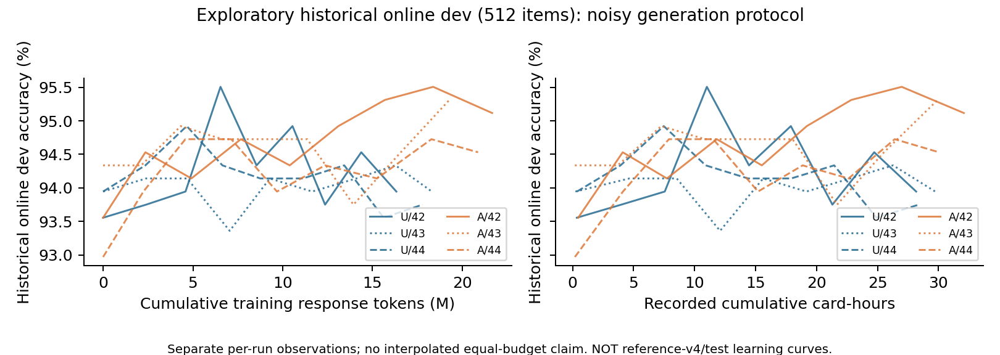
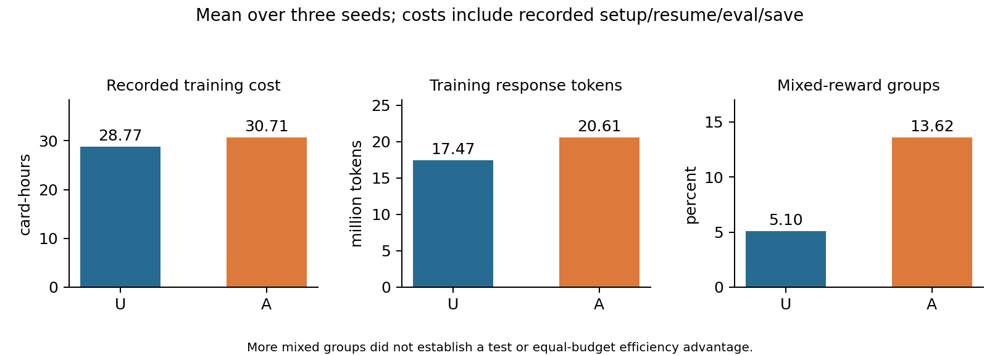

# 实验、结果及负结果

## 协议

GSM8K main，固定 seed42 从官方 7,473 训练题划出 512 开发题，再取 2,048 训练池；官方 test 1,319。3879 个项目 ID 在 manifest 中无交叉；本轮不重新读取完整原始题目，文本归一化去重由历史准备代码及后续测试支持。公开基座可能接触公开基准，无法证明训练前零接触。

模型 Qwen3.5-9B revision `c202236235762e1c871ad0ccb60c8ee5ba337b9a`，数据 revision `740312add88f781978c0658806c59bc2815b9866`。每组 200 次更新、64 题/步、4 回答/题，共 12,800 题目出现、51,200 新回答；有重复，不代表 12,800 道独立题。前20步均匀，25步评开发集，正式每2步保存完整点，保留最新两点及最佳点。

lr1e-6；clip0.2；KL loss0.001；任务奖励不混 KL；组优势 std 归一化；token-mean；单卡微批量8；prompt512/response1024；thinking=false。全参 FP32 master/BF16计算/CPU卸载，原环境核心 torch2.11/cu129、vLLM0.24、transformers5.9、verl0.9.1。

|组别|唯一改变|种子|
|---|---|---|
|U|均匀有放回|42/43/44|
|A|在线 EMA.3，p(1-p)，20%均匀探索|42/43/44|
|S|预热结束后冻结成功率；访问数仍更新|42|
|E|去掉探索；全零分数仍回退均匀|42|

## 官方测试划分

greedy n=1、TP1、BF16、eager、固定128题分块，prefix cache/引擎多进程/async scheduling关闭；seed42，哈希种子0、cuBLAS固定工作区、TF32关闭。严格 `#### number`，千位分隔/负数/小数规范化；不接受分数表达、单位换算或多次最终标记。未以 EOS 结束记0，可能同时格式错误，不重复相加。

|seed|U200 正确数/1319|A200 正确数/1319|A−U百分点|
|---|---:|---:|---:|
|42|1268 (96.13%)|1251 (94.84%)|−1.29|
|43|1253 (95.00%)|1264 (95.83%)|+0.83|
|44|1253 (95.00%)|1254 (95.07%)|+0.08|

主终点 U95.38±0.66%，A95.25±0.52%；次终点 U94.47±0.42%，A95.58±0.57%。17角色引用15权重，共享权重复用输出。基座两张卡的独立冷进程输出投影完全一致；其余14权重 test 各一次，虽此前 dev 双次核验通过，也不称其 test 全部重复验证。

U42/A42/S42/E42 在测试固定终点分别为96.13/94.84/94.69/95.53%；原在线选点分别为94.01(step75)/95.98(step175)/95.22(step75)/95.53(step200)。S/E单种子不能外推一般结论。

## 开发集与统计口径

参考v4 dev512固定终点：U93.82±0.11%，A94.86±0.11%；原在线选点参考复评：U95.18±0.60%，A94.86±0.23%。S/E200分别95.31/94.73%。这是 dev 结果，不能与 test 行混成提升曲线。

跨种子样本标准差 n=3，未做统计显著性结论。配对题集相关，同一题重复在三个模型上不能扩充独立样本数。冻结计划与代码支持“先选点后测试”的流程设计；仅凭交接包不能证明文件生成全过程从未被人工修改。

## 成本与采样多样性

|三种子训练均值|U|A|
|---|---:|---:|
|已记录卡时|28.77|30.71|
|训练回答token|17.47M|20.61M|
|混合奖励组比例|5.10%|13.62%|

A 多6.74%卡时和17.94%生成token。固定200步不等于等成本；恢复次数和保存/验证开销也会影响账本。评测控制器两卡预留时间与子任务成本重叠，不能直接相加。公开历史在线 dev 曲线仅作探索性描述，可按 token/卡时横轴查看，**不能证明等预算参考测试优势**；被清理的中间权重使完整确定性曲线不可补齐。

|seed42末端状态|U|A|S|E|
|---|---:|---:|---:|---:|
|零概率题数|0|0|0|1892|
|最大单题概率|0.049%|62.55%|0.080%|99.68%|
|exp(熵)有效题数|2048|26.76|1514.88|1.04|

快照位于第200步反馈后、下一批采样前。它不代表全程平均：E最后两步128次出现涉及79道不同题，单题最多4次。A有正的探索下界仍可能集中；边界成功率、EMA噪声与统计滞后是待检验机制，没有完整概率轨迹，不给唯一因果解释。

## 结论与后续研究

当前证据支持“混合组增加”，不支持“稳定泛化提升/效率提高”。次终点好而主终点无提升提示选点敏感性。合理后续是假设成功率估计加平滑、概率温度/上限及难基准，但需新开发规则和预先固定预算；不应反复针对本 test 调参。

本轮仅核对现有数据和生成公开统计图，没有追加训练。完整历史证据私有保存，公开摘要和评分文件是有来源映射的派生产物，并非原始预测。

## 历史预算曲线（探索性）

图中每条线为单组历史在线观测，不插值推断共同预算收益，不能与参考v4或test终点拼接。

## 逐步监控与分阶段耗时

公开 `evidence/training-metrics.jsonl` 包含8组各200步的标量投影，保留混合/全对/全错、覆盖率、长度、KL loss、生成/打分/旧策略与参考概率/actor更新/同步/保存/开发评测耗时。若重启产生同一步记录，仅取该步最后一条含study训练指标的记录；未把重复初始化验证当更新。来源文件SHA和提取规则见evidence-map。

预热后step21–200、U/A各3seed全部步骤的等步平均：生成约17.99/20.92秒，actor更新约157.25/167.59秒（U/A；具体以原字段复算为准）。不同阶段/上游timer可能有嵌套，不把全部timer简单相加为独立成本。长度上限clip_ratio与严格EOS判零率是不同指标，不混称。
